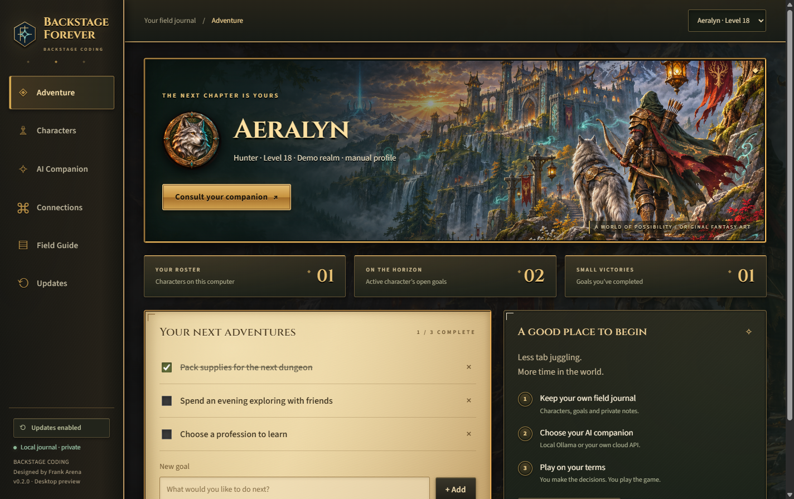

# Backstage Forever

**Your adventure notebook and optional AI companion, from Backstage Coding. Designed by Frank Arena.**



**[Download the Windows preview](https://github.com/farena-ai/Backstage-Forever/releases)** · **[Install and get started](docs/GETTING-STARTED.md)** · **[Choose an AI connection](docs/PROVIDERS.md)**

Version **0.2.0 is a desktop preview** with cinematic original fantasy artwork, textured journals and authenticated automatic Windows updates. Create characters, track goals and keep notes locally, with or without AI. Each friend installs their own copy and connects their own account. No shared backend or owner's credentials are included.

## Install

1. Open [Releases](https://github.com/farena-ai/Backstage-Forever/releases) and select the Windows setup executable attached to the preview release.
2. If downloading a ZIP, extract it first. Run the setup executable for your Windows account.
3. Launch Backstage Forever and create a character. Continue offline, or open Connections to configure AI.

The installer is **unsigned**. Windows may display an unknown-publisher warning; verify the download source before proceeding. Signing and clean-machine installation/upgrade acceptance remain pending. See [Getting started](docs/GETTING-STARTED.md) for full beginner instructions, backups and deletion.

## What this preview includes

- Local character profiles, goals and private notes; backup/import/reset controls.
- Painted citadel scenery, an embossed companion medallion, bronze/leather framing and a parchment journal, with bundled offline fonts.
- Automatic checks and downloads of authenticated releases, installation on exit, restart-now and preference controls.
- Optional Ollama locally, or OpenAI, Anthropic and xAI API connections with your own key and model selection.
- Explicit ChatGPT browser subscription authentication and Claude subscription authentication through the separately installed official Claude Code tool, using app-private credentials.
- Character sharing off by default. Opt in to send name, realm, class and level; notes and goals are excluded from automatic context.

API adapters and subscription transports have fixture coverage. **Live interactive subscription consent and paid inference acceptance have not been performed.** Fixtures do not prove account eligibility, live API access or billing coverage. API mode and subscription mode are separate; errors do not silently switch to API charging. This preview supports one saved ChatGPT registration/account per installation; reset app data to switch accounts, after exporting your profiles if needed.

Grok subscription mode is currently unavailable in the interface. Official Grok OAuth exists, but an isolated inference adapter is deferred pending a verified tools/hooks boundary. Use xAI API mode in this preview.

The desktop uses manual game records. It does not inspect or play the game, calculate combat decisions or provide a live connection. The optional addon is an experimental manual-copy prototype; client/API compatibility remains unverified. See [Compatibility](docs/COMPATIBILITY.md) and the [Roadmap](docs/ROADMAP.md).

## Your data

Profiles stay in this Windows account's app-data folder. API keys are encrypted separately and never included in exported backups. Subscription credentials are also excluded; Claude's official tool manages its own app-private credential files. Prompts you send go to your selected provider. Read [Privacy](docs/PRIVACY.md) and [Providers](docs/PROVIDERS.md) before connecting.

Installed Windows builds check shortly after startup and every six hours while open, download verified updates, and install on exit by default. The Updates screen offers manual checks, restart-now and preference controls. No forced mid-game restart or external watcher job is created. **0.1.0 needs one manual installer upgrade to gain this updater.** See [Automatic updates](docs/UPDATES.md). Source builds never automatically check or run installers.

## Run or build from source

Install Node.js LTS with npm, extract the complete source archive, and open PowerShell in the project folder:

```powershell
npm ci
npm start
npm test
npm run test:ui
npm run test:integration
npm run dist
```

`npm start` opens the desktop. `npm run dist` builds the Windows installer in the configured output folder. See [Validation](docs/VALIDATION.md) for measured results and [Releasing](docs/RELEASING.md) for release gates.

```text
src/
  main.cjs            Desktop lifecycle and validated app bridge
  preload.cjs         Narrow interface available to the screen
  core/               Local storage, providers and authentication
  renderer/           Local interface and styles
assets/               Original vector artwork and preview image
addon/                Optional experimental manual-copy prototype
tests/                Local, protocol-fixture and integration checks
docs/                 Setup, privacy, compatibility and release evidence
```

## Artwork and license

The painted environment and medallion are original generated fantasy artwork bundled locally; no Blizzard artwork or game assets were copied. The original Backstage crest remains in the identity system. Bundled Cinzel and Source Sans 3 fonts include their SIL Open Font License notices. See [Artwork notes](docs/ARTWORK.md). Brand and product design: Frank Arena, Backstage Coding.

Licensed under [MIT](LICENSE). This project is not an official Blizzard product. See [Security](SECURITY.md) and [Changelog](CHANGELOG.md).
