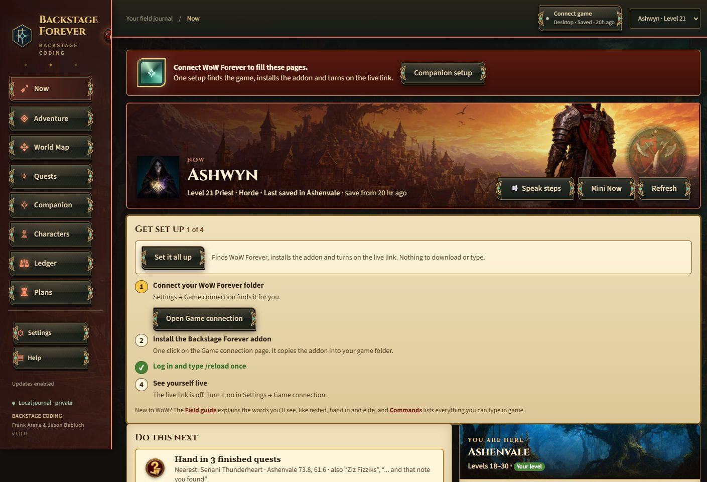

<h1 align="center">Backstage Forever</h1>

<strong>A free leveling companion for World of Warcraft: Forever.</strong> 
It reads your own game, tells you what to do next, and guides you there: in the game and on your desktop.

<a href="https://github.com/farena-ai/Backstage-Forever/releases/latest">Download</a> · <a href="#what-it-does">What it does</a> · <a href="#privacy-at-a-glance">Privacy</a> · <a href="CHANGELOG.md">Changelog</a> · <a href="docs/GETTING-STARTED.md">Getting started</a>

## What's new

**1.6:** a picture of your badges, and shopping lists that check your other characters. **1.5:** flowing map routes and footprints, painted final bosses, velvet loot trays and big moments. **1.4:** plan by the time you have, quick answers for class unlocks, boss tips and reputation, a weekly recap and reminders, and routes that grow as you play. **1.3:** class unlocks, training costs, a riding-and-mount goal, reputation advice and boss tips. **1.2:** badges in game, gathering spots on the World Map, prices and quest use on item tooltips, `/bf sell`, a Gear sets button and quest icons over enemies. **1.1:** a Badges page for every character, and 14 new badges. **1.0.2:** the release checksum list checks cleanly on a Mac. **1.0.1:** the Mac app tells you when a new version is out and its first-run checklist finishes; the companion knows which side you mean from the race or city you name; class training points to the capital next door. **1.0:** the first stable release. **0.59:** the companion understands more (100% on questions it had never seen), the addon on its own with each release. **0.58:** the companion understands what you ask (15% → 97% on a 100-question benchmark), your character's own portrait, a painting for every dungeon. **0.57.3:** one /reload after an update. **0.57.2:** Professions advice from your recipes. **0.57.1:** Professions read your recipes. **0.57:** the rest of the app in German and the 1.0 checklist. **0.56:** ready for the public: this front page, plain-language privacy, a security policy and a new Getting started. **0.55:** a Mac app for Apple Silicon and Intel (without the live link). **0.54:** every page reviewed in English and German, and the in-game Adventure Compass shows your XP, pace, quests ready to hand in and next step at a glance. See the [release notes](docs/releases/1.6.0.md) and the [changelog](CHANGELOG.md) for every version.

## What it does

Backstage Forever is two parts that work together: a **desktop app** and a small **in-game addon**. The app installs and updates the addon for you.

**In the game**
- **One step at a time.** `/bf route guide` follows a step-by-step route for your race from level 1: pick up, do, hand in, next zone, with the game's own arrow on each step. `/bf next`, `/bf train` and `/bf find` point the arrow at what you need.
- **Know what you're looking at.** Quest progress in enemy tooltips, warnings over dangerous targets, enemy player alerts on contested ground, and the best quest reward for your class highlighted.
- **Small helpers.** Repair and supply reminders, an arrow back to your body, a sell-junk button, flight path and hearthstone tips, and optional quality-of-life switches (`/bf qol`).
- **Ask without alt-tabbing.** Click the owl on the minimap and ask the companion; the answer appears in a panel over your game.

**On your desktop**
- **Now** shows your next step, where to level, your quest log and training, live as you play. **Mini Now** keeps the next step beside the game, and it can read steps aloud.
- **World Map** with your game's own map art, painted pins for quest givers, trainers, vendors, herbs and ore, your path this session and a radar.
- **Characters**: every character at a glance with rested XP and who to play tonight, a character sheet with upgrades and gear sets, talents, badges, speed splits and past sessions.
- **Adventure**: the guided route, every zone with your quest progress, dungeons and raids with their loot, and profession plans.
- **Ledger**: bags, bank and mail across characters, gold, the auction prices you saw, reputation and cooldowns.
- **The companion** answers questions about quests, places, items and talents, and plans your night. It works with no setup, with a free AI on your own PC, or with the AI provider you choose.

Horde and Alliance are covered alike. The full list of in-game commands is on **Help → Commands** in the app.

## Install

**Windows 10 or 11:** download `Backstage-Forever-<version>-Windows-x64-Setup.exe` from the [latest release](https://github.com/farena-ai/Backstage-Forever/releases/latest) and run it. Windows may warn that the installer is from an unknown publisher (it isn't code-signed yet): choose **More info → Run anyway**. The app updates itself after that.

**macOS (Apple silicon or Intel):** download the `macOS-arm64` or `macOS-x64` zip, unzip it and move **Backstage Forever** to Applications. The app isn't notarized yet, so the first time macOS says it can't check it: open **System Settings → Privacy & Security**, scroll down and click **Open Anyway** (on macOS 14 and older, right-click the app and choose **Open**). On a Mac the live link is not available yet; everything that works from your saved characters does, and the app tells you when a new version is out.

Then open the app and click **Set it all up**: it finds World of Warcraft: Forever, installs the addon and turns on the live link. Log in and play. The [getting started guide](docs/GETTING-STARTED.md) has the details.

## Privacy at a glance

Your characters, notes, sessions and settings stay on your computer. Backstage Forever never reads your account, password or chat, never sends input to the game and never plays for you. What can leave your computer, and only when you use it:

| What | Where it goes | When |
|---|---|---|
| Anonymous gathering spots and creature positions (rounded, with a random install id) | The community service at bf.backstagecoding.com | Community sharing is on by default; switch it off in Settings → Game connection |
| Your question and, if you allow it, your character's details | The AI provider you choose | Only when you ask the companion with a cloud AI (the free local AI and quick answers stay on your PC) |
| Update checks | GitHub releases | Windows app, automatically; you can turn it off |
| Quest progress (quest numbers and counts) | Your party members who also run the addon | Party sync, in a party only; `/bf party off` stops it |

The full details are in [docs/PRIVACY.md](docs/PRIVACY.md).

## Good to know

- **The live link.** The addon draws a one-pixel line at the top edge of the game; the app reads it from the game's window to follow you live (Windows). Nothing else is read from the game, and the addon only uses Blizzard's public addon interface.
- **Fair play.** The addon never automates anything: no auto-accepting, no clicking, no movement, nothing in combat that the game doesn't allow a normal addon.
- **Languages.** English and German (machine-translated, marked as such). Fixes are welcome: see [docs](scripts/i18n/README.md).
- **Accessibility.** Screen-reader labels, keyboard navigation, reduced motion and high-contrast support; see the [style guide](docs/STYLE-GUIDE.md).

## Building from source

Node.js 24 and npm. `npm ci`, then `npm start` runs the app and `npm test` runs the unit tests. `npm run dist` builds the Windows installer and `npm run dist:mac` the Mac zips. See [docs/RELEASING.md](docs/RELEASING.md) and [CONTRIBUTING.md](CONTRIBUTING.md).

## Credits

Designed by Frank Arena and Jason Babiuch, made by [Backstage Coding](https://www.backstagecoding.com). All artwork is original, painted for Backstage Forever (see [art notices](src/renderer/art/NOTICE.md)). Quest, NPC and item reference data comes from Efficient Games (CC BY 4.0) and players' own play; see [third-party notices](docs/THIRD-PARTY-NOTICES.md).

**Not affiliated with Blizzard Entertainment.** World of Warcraft, Warcraft and Blizzard Entertainment are trademarks or registered trademarks of Blizzard Entertainment, Inc. Backstage Forever is an independent fan project; it does not include or redistribute any Blizzard game files, and it reads map art and game data only from your own installation, on your own computer.

Released under the [MIT License](LICENSE).
