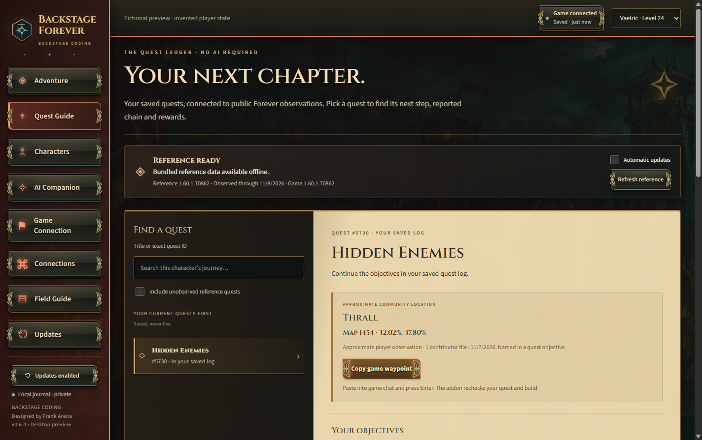

# Backstage Forever

## 0.18 preview: a leveling advisor that works with you live

The app now opens on **Now**: what to do next (hand in, train, continue a quest, or where to level), the zones that fit your level with the quests you can pick up there, your class training now and next, and your quest log, all following your live position. Inside WoW, a **BF Guide** layer on the world map shows quests you can pick up (checked live against your level, faction and completed quests), hand-ins, your class trainer, profession trainers and flight masters; `/bf next` points WoW's own arrow at the nearest one. See the [0.18.0 release notes](docs/releases/0.18.0.md) and [0.18.1](docs/releases/0.18.1.md).

## 0.16 preview: your game's own maps, live

The World Map and radar draw each zone's real map art straight from your WoW Forever install (read on your PC, never uploaded), with your live arrow on top. The live link is on by default. See the [0.16.0 release notes](docs/releases/0.16.0.md) and [0.17.0](docs/releases/0.17.0.md) for clearer pins and NPC cards.

## 0.15 preview: find anything, see where you are

A graphical **World Map** with your live arrow, quest/flight/trainer/vendor/herb/ore pins, "Near you" and a cross-zone finder; **/bf find** and **/bf way** waypoints inside WoW; and an **Instance Atlas** coloured for your level. See the [0.15.0 release notes](docs/releases/0.15.0.md).

## 0.14 preview: the companion goes live

AI answers now **look things up** in the bundled Forever references, instead of saying "I don't have that". Ask where an NPC is, walk through a quest, find an item or plan a trip, and every fact comes with its source. The optional **live game link** (`/bf live on`, then Settings → Game connection) lets the desktop and AI know where you are right now, without `/reload`. See the [0.14.1 release notes](docs/releases/0.14.1.md) and [Living Companion](docs/LIVING-COMPANION.md#live-game-link-optional). **1.0 remains held.**

## Proactive Compass — 0.13 preview, 1.0 held

Adventure now recommends one useful next step and up to two alternatives: make room in nearly full bags, work on observed quests, attempt a learned skill-up-capable recipe with established carried materials, or check whether further profession training is available. **Adventure**, **Quests**, and **Professions** change the priorities. Unknown or partial inventory never means craft-ready, and skill-ups/output are never guaranteed. No bank/alt pooling, invented trainers, routes, prices or material sources are added.

Inside WoW the Compass updates from permitted current capture events without AI or the desktop. **Not now** quietly dismisses that recommendation for its current facts; unrelated XP or capture timestamps do not bring it back. Relevant progress can resurface it. Dismissals are bounded to 20 entries for the current session and never complete quests. **Quest details** exposes the existing Focus and minutes/card-limit controls; **Less** folds them away. Hide, collapse, drag and `/bf show`, `/bf hide`, `/bf status` remain. Only an explicitly displayed supported quest step can offer a manual waypoint.

On desktop, Adventure's Compass is explicitly **Last saved** and **No AI**. Its goal preference is independent of the in-game preference. Use **Review quest choices** for the detailed Director or **Open Professions** for the single workshop under Adventure → Professions. The five main navigation sections and all existing destinations remain. Native goal preferences survive addon updates; setup/repair owns twelve files and preserves unrelated addon files. This preview is version **0.13.7**; **1.0 and actual in-client acceptance remain held**.

## Find your way around

The journal has five main sections: **Adventure** for your next step, **Quests** for the saved quest atlas, **Companion** for questions and local travel, **Characters** for your roster, and **Plans** for checklists. Adventure contains **Next step**, **Professions** (your saved workshop), and **Map** (last-saved coordinates). Plans contains **My plans** (formerly Company), **Party**, and a shortcut to Professions. **Settings** contains **Game connection**, **AI connection** (formerly Connections), and **Updates**. **Help → Field guide** contains support reports, recovery checkpoints, and backup tools.

Voice, Memory, and quest reference details open when you need them. Folding Voice stops pending or active speech. The memory summary always shows how many exchanges are selected for this question; saving an exchange does not consent to sharing it. Provider costs and character-sharing choices remain visible. Local travel has a **Show road guide** shortcut when a road alternative is documented; **How we know** holds dated source details. These are guides and manual plans, never game actions.

Manual character creation offers Forever's nine confirmed classes plus Other. Existing imported or custom class names remain unchanged. Original class and faction artwork remains in use. The preview version is 0.13.7; 1.0 publication remains held for owner review.


**Your character command center and Forever quest companion, from Backstage Coding. Designed by Frank Arena.**

**0.13 preview:** support diagnostics, automatic recovery, richer qualified references, conversation and travel improvements, the reorganized sidebar, Proactive Compass, Professions and Map are prepared for the normal authenticated Windows update channel. Historical local review bundles remain unchanged. **1.0 stays held for the hands-on check.**



*Fictional player state with qualified public reference facts; your selected character shapes the original class and faction presentation.*

**[Download the Windows preview](https://github.com/farena-ai/Backstage-Forever/releases)** · **[Install and get started](docs/GETTING-STARTED.md)** · **[Choose an AI connection](docs/PROVIDERS.md)**

Version **0.14.1 adds tool-using AI lookups and an optional live game link on top of 0.13.7, which prepared local NPC locations, honest current-location context and connection-screen timing polish for the installed preview** before Frank Arena's hands-on 1.0 review. Connection checks and optional activation keep your open or closed choice during same-screen status updates. It retains an explained next-action Director, profession and material planning, optional local Windows voice, deliberate per-character conversation memory, and reviewed party-plan files. Automatic setup and the local in-game Compass work without an AI account or routine reloads. The desktop keeps last-saved snapshots, plans, journal, Quest Guide and optional AI. Local NPC lookup works without a model: compatible observed-build points take priority over a separately qualified 616-NPC historical reference. Explicit current player reports are labelled separately from saved locations; asking where an NPC is does not report where you are. Exact quest IDs, compatible builds and source labels keep reference facts qualified. Each friend installs their own copy and connects their own account. No shared backend or owner's credentials are included.

## Install

1. Open [Releases](https://github.com/farena-ai/Backstage-Forever/releases), choose the newest published Windows preview, and download its file ending **-Windows-x64-Setup.exe** under **Assets**.
2. Run that setup executable for your Windows account. The **Source.zip** archive contains developer code, not the installer; normal installation needs no Node.js or source commands.
3. Launch Backstage Forever and choose **Start my adventure**. It finds your Forever client, prepares and verifies its addon, and offers a simple choice if needed. You can start playing once the files are prepared; no desktop snapshot or AI setup is required first. Enable/load the addon in-game if needed.

Once installed, native guidance can work with the desktop app closed. Logout/game exit saves your character back to the desktop. A voluntary UI reload is available when you specifically want a fresh desktop snapshot or need to load an addon update. See [Living Companion](docs/LIVING-COMPANION.md) for the two views of your adventure.

The installer is **unsigned**. Windows may display an unknown-publisher warning; verify the download source before proceeding. Windows publisher signing and clean-machine installation/upgrade acceptance remain pending. App-update downloads use a separate pinned Ed25519 signature and installer hash/size verification. See [Getting started](docs/GETTING-STARTED.md) for full beginner instructions, backups and deletion.

## What this preview includes

- **Character field guide** automatically follows the selected saved character, with class/faction artwork, observed equipment, dated class identity and qualified historical training. Search trainer/spell records locally, create a reusable manual Company checklist, or open a reviewed editable public question. No AI account is required. Custom races stay literal; unverified racial mechanics and equipment suitability stay unknown. See [Character guidance](docs/CHARACTER-GUIDANCE.md).
- **Bundled field notes** add exact-source quest sharing reports, static duration, starting items and reported drops beneath the primary quest action. The base remains 3,884 quests; these facts add evidence types rather than complete prerequisites or missing destinations. See [Reference coverage](docs/FOREVER-DATA.md).
- **Support diagnostics** prepares a fixed allowlisted report for exact preview, copy and save. No automatic upload, log dump, credentials, character identity, journal text or private paths. See [Support and recovery](docs/SUPPORT-AND-RECOVERY.md).

- **Adventure Director** explains one next quest action and up to two alternatives. **Start quest session** creates or reuses a tracked Company plan without an AI request. Session length limits plan size, not a promised completion time. See [Director help](docs/ADVENTURE-DIRECTOR.md).
- **Adventure → Professions** shows observed professions, known recipes and dated carried materials. Auto selects a useful observed learned recipe; choose an owned profession, an explicit saved recipe or 1–20 craft attempts if wanted. Choices autosave separately from native goals; attempts do not guarantee output or skill gains. Exact shortfalls require complete applicable counts; partial observations stay qualified, and alts are not silently pooled. Add a manual shopping checklist without crafting or buying anything. See [Preparation help](docs/PREPARATION.md).
- **Party** offers an explicit role choice and manual dungeon-preparation checklist. Preview and edit every portable line before saving a plan file; importing adds new manual, unassigned steps without completion proof. Sharing happens only through the method you choose. See [Party plans](docs/PARTY-PLANS.md).
- Optional **local Windows voice** creates an editable draft while you hold the control; release and review before Send. Explicit reading and Stop are separate. Typed input remains available. Save a reviewed exchange as local character memory only when wanted, then separately select specific memories for each future question. See [Voice and memory](docs/VOICE-AND-MEMORY.md).
- **Plans → My plans** (Company) brings collected characters, ready turn-ins, private goals and known preparation facts together, with existing class/faction artwork and explicit saved-data labels. Choosing a character is deliberate; browsing the overview does not switch it.
- Local shared journeys with editable quest-session/dungeon-preparation checklists, manual steps and steps linked to a saved character's observed quest. New compatible completion evidence can check a tracked quest automatically; ready objectives, missing quests and historical completion alone do not prove a new turn-in. Plans remain private and included in deliberate backups. See [Adventure Company](docs/ADVENTURE-COMPANY.md).
- A quiet native bag-space cue from current supported observations, clearing when space improves. Unknown or zero reported capacity is not treated as a full bag. No sounds, repeated notifications or automatic game actions.
- An event-driven native Adventure Compass with current quest steps, per-character focus/session preferences, clear source labels and a player-controlled waypoint action. It updates outside combat, hides during combat and works without desktop AI or routine reloads.
- A local Quest Guide with build-specific Forever facts, reported chains, quest givers/turn-ins, approximate observed locations, reward choices and inspectable sources. The initial pack is bundled; optional automatic whole-build reference checks need no AI account and send no character details. Coverage is partial; cache records and chain links do not prove playability or every prerequisite. See [Forever reference coverage](docs/FOREVER-DATA.md).
- Player-controlled **Copy game waypoint** commands for compatible supported destinations. Paste the prepared command into WoW; the addon checks the build and quest phase before placing a marker or printing coordinates. No automatic movement, combat, interaction or map opening.
- Bounded automatic retries and clear recovery for interrupted app updates. If an older updater cannot download the new release, use the official Windows installer once to receive the fixes. See [update recovery](docs/UPDATES.md#recovering-a-failed-update).

- Local character profiles, goals and private notes; automatic bounded local recovery points, deliberate preview/restore and backup/import/reset controls. See [Support and recovery](docs/SUPPORT-AND-RECOVERY.md).
- Painted citadel scenery, an embossed companion medallion, bronze/leather framing and a parchment journal, with bundled offline fonts.
- Automatic checks and downloads of authenticated releases, installation on exit, restart-now and preference controls.
- Optional offline local Ollama, separate Ollama Cloud, or OpenAI, Anthropic and xAI API connections with your own key. Friendly model catalogs refresh on startup, connection opening, authentication, saving and manual refresh; no paid inference probes or silent provider/model/billing fallback.
- Explicit ChatGPT browser subscription authentication and Claude subscription authentication through the separately installed official Claude Code tool, using app-private credentials.
- One-action first-run setup discovers the Forever client, prepares/verifies twelve managed addon files and offers a folder choice only when needed. Running-game awareness distinguishes next-launch activation from saved imports. Valid account exports are combined while preserving character identity, notes, goals and intentional selection. Saved-file checks run every five seconds while open.
- A character command center automatically builds source-backed quest steps from saved objectives, ready turn-ins and game-provided destinations. Session length/focus preferences save per character, and evidence stays inspectable. No AI connection is required for local plans. Missing data remains unknown; the planner does not invent quest chains or routes. See [Guidance](docs/GUIDANCE.md).
- Optional public equipped-item and bag-capacity observations stay local; unavailable APIs do not block character capture.
- A local adventure dashboard shows observed quests/objectives, ready turn-ins, XP, recent observed completions and actual public-API waypoints when available. An optional draggable/collapsible in-game Adventure Compass updates out of combat and hides during combat; `/bf show`, `/bf hide` and `/bf status` control it. This is not a complete quest database or optimal route planner.
- Connections, models and character fields save automatically; text fields and encrypted API keys save when focus leaves them. Notes persist locally. Enter sends an explicit AI question; Shift+Enter adds a line, with input-method composition preserved.
- A permanent World of Warcraft: Forever specialist, with a local gate for obvious unrelated requests and a shared provider policy. The gate is a heuristic, not a perfect classifier. No code execution or gameplay automation.
- **Use my active character is on by default**, with a persistent opt-out and visible context preview. The preview shows bounded public identity, race/faction, location, snapshot time, quest/objective details, XP and recent observed completion history that accompany a submitted question; notes, goals, shared journeys, raw GUIDs, account identifiers and paths are excluded.

API adapters and subscription transports have fixture coverage. **Live interactive subscription consent and paid inference acceptance have not been performed.** Fixtures do not prove account eligibility, live API access or billing coverage. API mode and subscription mode are separate; errors do not silently switch to API charging. This preview supports one saved ChatGPT registration/account per installation; reset app data to switch accounts, after exporting your profiles if needed.

Grok subscription mode is currently unavailable in the interface. Official Grok OAuth exists, but an isolated inference adapter is deferred pending a verified tools/hooks boundary. Use xAI API mode in this preview.

Native guidance updates while you play outside combat; routine reloads are not required. The desktop receives saved captures on logout/game exit or optional UI reload. Five-second desktop checks cannot make unsaved game data live. Only characters visited with the addon enabled can be known. The latest saved active character controls following; deliberate selection pauses it until you restore the checkbox. No account-wide login or continuous desktop feed is added. Read [Living Companion](docs/LIVING-COMPANION.md), [Game Connection](docs/GAME-CONNECTION.md) and [Compatibility](docs/COMPATIBILITY.md).

ChatGPT account catalogs determine visible subscription models; API catalogs and Claude CLI initialization do not guarantee plan entitlement. ChatGPT subscription access and API billing are separate. Claude uses the official CLI with an app-private profile and no API fallback.

Nine original class portraits and Alliance/Horde environments shape the selected character's dashboard, roster and journal. Unknown classes and factions retain neutral fallback. These illustrations are not portraits captured from your actual character.

## Your data

Profiles stay in this Windows account's app-data folder. API keys are encrypted separately and never included in exported backups. Subscription credentials are also excluded; Claude's official tool manages its own app-private credential files. Ordinary chat is temporary; explicitly saved character memory is readable local data and is excluded from profile backups. Replacement import/reset clears memory. Saving an exchange does not select it for future sharing. Prompts you explicitly send go to your selected provider. Read [Privacy](docs/PRIVACY.md) and [Providers](docs/PROVIDERS.md) before connecting.

For an identified journal startup fault, a valid local point can offer **Restore and restart**, preserving the exact damaged original locally. That original may contain memory/private text; see the recovery retention instructions. For any startup failure, choose **Open data folder** in the error dialog to find the actual directory, then follow [If the app cannot start](docs/GETTING-STARTED.md#if-the-app-cannot-start). Preserve a copy of the entire folder before any manual recovery action; a startup failure alone does not identify which component failed.

Installed Windows builds check shortly after startup and every six hours while open, download verified updates, and install on exit by default. The Updates screen offers manual checks, restart-now and preference controls. No forced mid-game restart or external watcher job is created. **0.1.0 needs one manual installer upgrade to gain this updater.** See [Automatic updates](docs/UPDATES.md). Source builds never automatically check or run installers.

## Run or build from source

Install Node.js LTS with npm, extract the complete source archive, and open PowerShell in the project folder:

```powershell
npm ci
npm start
npm test
npm run check:addon-reference
npm run check:forever-vendors
npm run test:ui
npm run test:setup
npm run test:autosave
npm run test:integration
npm run test:command-center
npm run test:knowledge
npm run test:living-backend
npm run test:living-setup
npm run test:company-backend
npm run test:company
npm run test:director-backend
npm run test:director
npm run test:preparation-backend
npm run test:preparation
npm run test:memory-backend
npm run test:voice-backend
npm run test:voice-memory
npm run test:companion-recovery
npm run test:product-polish
npm run test:support
npm run test:recovery
npm run check:forever-insights
npm run test:insights
npm run test:character-guidance
npm run test:party-backend
npm run test:party
npm run dist
npm run test:packaged
```

`npm start` opens the desktop. `npm run dist` builds the Windows installer in the configured output folder. See [Validation](docs/VALIDATION.md) for measured results and [Releasing](docs/RELEASING.md) for release gates.

Run Electron checks one at a time; competing desktop windows can invalidate keyboard/focus evidence. The recovery and product-polish checks use isolated synthetic data, fake providers and fake audio workers. See the [whole-product readiness assessment](docs/PRODUCT-READINESS.md) for the pre-1.0 corrections and remaining owner checks. See the [0.13 release notes](docs/releases/0.13.7.md) for this preview and the separate owner acceptance gates.

```text
src/
  main.cjs            Desktop lifecycle and validated app bridge
  preload.cjs         Narrow interface available to the screen
  core/               Local storage, providers and authentication
  renderer/           Local interface and styles
assets/               Original vector artwork and preview image
addon/                Optional guarded SavedVariables companion addon
tests/                Local, protocol-fixture and integration checks
docs/                 Setup, privacy, compatibility and release evidence
```

## Artwork and license

The painted environment and medallion are original generated fantasy artwork bundled locally; no Blizzard artwork or game assets were copied. The original Backstage crest remains in the identity system. Bundled Cinzel and Source Sans 3 fonts include their SIL Open Font License notices. See [Artwork notes](docs/ARTWORK.md). Brand and product design: Frank Arena, Backstage Coding.

Application code is licensed under [MIT](LICENSE). Efficient Games' derived reference compilation retains [CC BY 4.0 attribution and notices](docs/THIRD-PARTY-NOTICES.md). This project is not an official Blizzard product. See [Security](SECURITY.md) and [Changelog](CHANGELOG.md).
